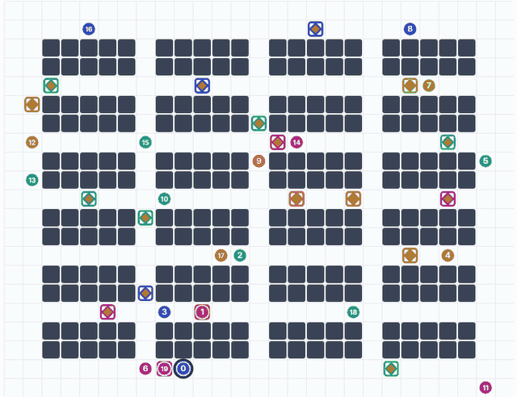
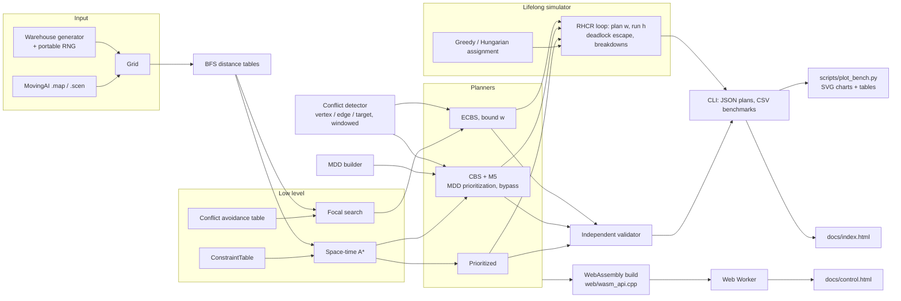
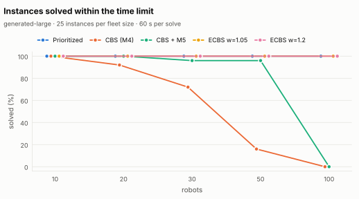
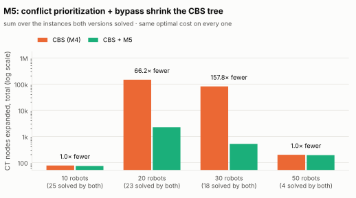
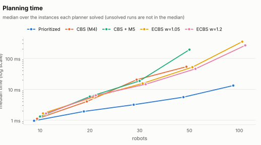
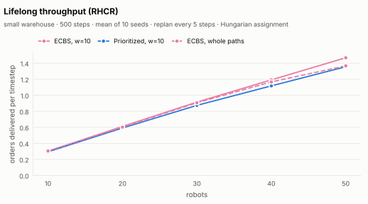
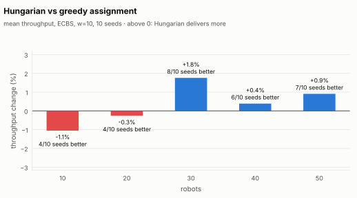

# SwarmGrid

[](https://github.com/tabish2786/SwarmGrid/actions/workflows/ci.yml)

Multi-Agent Path Finding (MAPF) for a warehouse robot fleet, in C++17: optimal Conflict-Based
Search with MDD conflict prioritization and bypass, bounded-suboptimal ECBS, prioritized planning,
optimal (Hungarian) order assignment, and a lifelong simulator with rolling-horizon replanning,
deadlock recovery and robot breakdowns. The only dependency is vendored
[doctest](https://github.com/doctest/doctest). The same C++ runs in the browser through WebAssembly.

<p align="center">
  
</p>

**Try it:** [dashboard](https://tabish2786.github.io/SwarmGrid/) (replays planner output) ·
[robot control](https://tabish2786.github.io/SwarmGrid/control.html) (10 to 50 robots, tap to send
a robot somewhere, run orders, break robots down, edit shelves; the planner runs on your device).

## The problem

A warehouse is a 4-connected grid of free cells and shelves. Each of *k* robots has a start and a
goal cell. Time is discrete; at every step a robot moves to a neighbouring cell or waits. Once it
reaches its goal it stays there. A plan is valid if no two robots ever

- stand on the same cell at the same time (**vertex conflict**),
- swap cells in one step (**edge conflict**), or
- drive through a cell where a robot has already parked for good (**target conflict**).

The objective is the **sum of costs** (sum of every robot's arrival time); the **makespan** (when the
last robot arrives) is reported too. Finding the optimum is NP-hard, which is why the project has
an optimal solver, a bounded-suboptimal one, and a fast incomplete one, and measures where each
stops working.

In the **lifelong** version, orders keep arriving: a robot drives to a parcel, then to a drop-off
station, then gets the next order. The measure there is **throughput**, orders delivered per step.

## Algorithms

| Module | What it does | Where |
|---|---|---|
| A* + BFS heuristic | Single-robot shortest path. The heuristic is the true distance around shelves (one BFS per goal), which beats Manhattan distance in a warehouse. | `astar`, `heuristic` |
| Space-time A* | Search over (cell, time) with vertex, edge and "blocked from t on" constraints, and the goal condition (a robot may only finish after the last constraint on its goal). | `space_time_astar`, `constraints` |
| Prioritized planning | Robots planned one by one, each avoiding the paths before it; on failure the stuck robot moves to the front and planning restarts. Fast, not optimal, not complete. | `prioritized` |
| CBS | Constraint tree searched best-first on sum of costs. Each node: one path per robot; split on a conflict, forbid it for one robot per child, replan only that robot. Optimal. | `cbs` |
| M5: MDD + bypass | Multi-valued decision diagrams of each robot's optimal paths classify conflicts as cardinal (both children must get more expensive), semi-cardinal or non-cardinal; CBS splits on cardinal ones first. Bypass: a child with the same cost and fewer conflicts replaces the parent's path instead of branching. Still optimal. | `mdd`, `cbs` |
| M6: ECBS | Focal search at both levels: any path or tree node within *w* × the current lower bound may be chosen, and among those the one with the fewest conflicts wins. Sum of costs ≤ *w* × optimal, guaranteed. | `ecbs` |
| Assignment | Greedy nearest pair, or optimal Hungarian (O(n³) shortest augmenting paths), both on true grid distances. | `task_assignment` |
| M8: Lifelong (RHCR) | Every *h* steps, replan the fleet but resolve conflicts only in the first *w* steps; execute *h* steps; repeat. Planner failures fall back to windowed prioritized planning, then to "everyone waits". A robot that makes no progress for 40 steps is sent to a nearby free cell, then resumes. Breakdowns turn a robot into a temporary shelf. | `lifelong` |

Everything is deterministic: a portable RNG (no `std::uniform_int_distribution`, whose output
differs between standard libraries), fixed neighbour order, and explicit tie-breaking in every
priority queue. The same seed gives identical output with GCC and Clang, on Linux and on Windows
(MinGW), and in the browser; CI compares macOS and MSVC on every push.

## Architecture



## Results

All numbers below come from `docs/bench/data/*.csv` through `scripts/plot_bench.py`; the full
tables are in [`docs/bench/summary.md`](docs/bench/summary.md). Every solved instance was
re-checked by the independent validator.

**M7 setup:** generated 100 × 36 warehouse (2,320 free cells), 10 to 100 robots, 25 random
instances per fleet size, 60 s per solve (see Limitations: not the MovingAI map).

- **50 robots:** plain CBS solved 4/25, CBS + M5 24/25, ECBS (w = 1.05 and 1.2) and prioritized
  planning 25/25.
- **100 robots:** neither CBS version solved any; ECBS w = 1.2 solved 25/25 (median 0.27 s) at a
  mean of 2.6% above the best known lower bound; prioritized planning solved 25/25 but 13.0%
  above it.
- **M5:** on the 18 instances with 30 robots that both versions solved, CBS + M5 expanded
  157.8× fewer constraint-tree nodes in total (4,187× on the best instance) with the same optimal
  cost. The gain is concentrated on the hard instances: on the median instance it is 1.3×.

<picture>
  <source media="(prefers-color-scheme: dark)" srcset="docs/bench/success-dark.svg">
  
</picture>

<picture>
  <source media="(prefers-color-scheme: dark)" srcset="docs/bench/cbs-m5-dark.svg">
  
</picture>

<picture>
  <source media="(prefers-color-scheme: dark)" srcset="docs/bench/runtime-dark.svg">
  
</picture>


**M8 setup:** lifelong simulation on the small 27 × 21 warehouse (1-wide aisles), 500 steps,
10 seeds per configuration, replan every h = 5 steps.

- **Throughput at 50 robots:** ECBS with a 10-step window delivered 1.468 orders per step,
  prioritized planning with the same window 1.356 (ECBS +8.3%), prioritized over whole paths 1.123.
- **Windowing helps:** at 50 robots ECBS with w = 10 beat ECBS over whole paths (1.367) by 7.4%;
  over whole paths ECBS gave up (2,000-node limit per replan) 352 times across the sweep and
  prioritized planning took over.
- **Cost:** ECBS w = 10 took 0.026 s per replan on average at 50 robots (max 1.09 s).
- **Safety:** 0 collisions in the executed motion over all 800 runs, re-checked step by step.
- **Hungarian assignment** cut robot-to-parcel distance per order by 1.0-2.1% from 20 robots up,
  but throughput moved by -1.1% to +1.8%, within the seed-to-seed spread: no measurable gain.

<picture>
  <source media="(prefers-color-scheme: dark)" srcset="docs/bench/lifelong-throughput-dark.svg">
  
</picture>

<picture>
  <source media="(prefers-color-scheme: dark)" srcset="docs/bench/assignment-dark.svg">
  
</picture>

<details>
<summary>All tables (same numbers as the charts)</summary>

### Benchmark: generated-large

25 instances per fleet size, 60 s per solve. Solved = finished within the limit with a plan the independent validator accepts.

| robots | Prioritized | CBS (M4) | CBS + M5 | ECBS w=1.05 | ECBS w=1.2 |
|---|---|---|---|---|---|
| 10 | 25/25 · 0.000965 s | 25/25 · 0.00112 s | 25/25 · 0.00132 s | 25/25 · 0.00167 s | 25/25 · 0.00165 s |
| 20 | 25/25 · 0.00193 s | 23/25 · 0.00405 s | 25/25 · 0.00585 s | 25/25 · 0.00557 s | 25/25 · 0.00637 s |
| 30 | 25/25 · 0.00319 s | 18/25 · 0.0205 s | 24/25 · 0.0188 s | 25/25 · 0.0156 s | 25/25 · 0.0146 s |
| 50 | 25/25 · 0.00561 s | 4/25 · 0.0541 s | 24/25 · 0.193 s | 25/25 · 0.0524 s | 25/25 · 0.0462 s |
| 100 | 25/25 · 0.0133 s | 0/25 | 0/25 | 25/25 · 0.35 s | 25/25 · 0.265 s |

Cell: solved / instances · median seconds over the solved ones.

**Solution cost vs the best known lower bound** (mean of cost / bound over instances the planner solved; the bound is the optimum when CBS solved it, else the largest ECBS lower bound):

| robots | Prioritized | CBS (M4) | CBS + M5 | ECBS w=1.05 | ECBS w=1.2 |
|---|---|---|---|---|---|
| 10 | 1.018 | 1.000 | 1.000 | 1.000 | 1.001 |
| 20 | 1.034 | 1.000 | 1.000 | 1.001 | 1.002 |
| 30 | 1.053 | 1.000 | 1.000 | 1.003 | 1.005 |
| 50 | 1.077 | 1.000 | 1.000 | 1.004 | 1.008 |
| 100 | 1.130 | – | – | 1.024 | 1.026 |

**M5 (CBS with MDD conflict prioritization + bypass) vs plain CBS**, instances both solved:

| robots | both solved | median CT nodes plain → M5 | total plain / total M5 | median per-instance ratio | best ratio |
|---|---|---|---|---|---|
| 10 | 25 | 2 → 2 | 1.0× | 1.0× | 2× |
| 20 | 23 | 10 → 10 | 66.2× | 1.0× | 133× |
| 30 | 18 | 42 → 20 | 157.8× | 1.3× | 4187× |
| 50 | 4 | 46 → 48 | 1.0× | 1.1× | 1× |

### Lifelong (RHCR) on the small warehouse

500 steps per run, mean of 10 seeds, replan every 5 steps (h), conflicts resolved for w steps. Throughput = orders delivered per timestep. Collisions in executed motion: 0 over 800 runs.

| robots | ECBS w=5 | ECBS w=10 | ECBS w=20 | ECBS w=whole | PP w=5 | PP w=10 | PP w=20 | PP w=whole |
|---|---|---|---|---|---|---|---|---|
| 10 | 0.299 | 0.301 | 0.305 | 0.305 | 0.299 | 0.296 | 0.289 | 0.291 |
| 20 | 0.606 | 0.611 | 0.610 | 0.603 | 0.590 | 0.592 | 0.571 | 0.550 |
| 30 | 0.892 | 0.915 | 0.899 | 0.907 | 0.860 | 0.874 | 0.816 | 0.783 |
| 40 | 1.168 | 1.192 | 1.179 | 1.166 | 1.121 | 1.117 | 1.038 | 0.984 |
| 50 | 1.425 | 1.468 | 1.419 | 1.367 | 1.364 | 1.356 | 1.210 | 1.123 |

(Hungarian assignment in all columns.)

| robots | planning time per replan, ECBS w=10 (mean / max s) | planner failures (fallback used) | deadlocks detected | escapes |
|---|---|---|---|---|
| 10 | 0.0003 / 0.003 | 0 | 0 | 0 |
| 20 | 0.0010 / 0.004 | 0 | 0 | 0 |
| 30 | 0.0036 / 0.062 | 0 | 0 | 0 |
| 40 | 0.0101 / 0.552 | 1 | 0 | 0 |
| 50 | 0.0256 / 1.088 | 4 | 0 | 0 |

**Deadlock recovery and fallbacks**, all runs of each configuration (both assignments, all fleet sizes):

| planner | window | stuck detections | escapes | main planner failed (fallback used) | everyone waited |
|---|---|---|---|---|---|
| ECBS | 5 | 2 | 2 | 0 | 0 |
| ECBS | 10 | 0 | 0 | 13 | 0 |
| ECBS | 20 | 6 | 6 | 108 | 0 |
| ECBS | whole paths | 32 | 32 | 352 | 0 |
| Prioritized | 5 | 37 | 74 | 8 | 8 |
| Prioritized | 10 | 23 | 24 | 0 | 0 |
| Prioritized | 20 | 274 | 287 | 0 | 0 |
| Prioritized | whole paths | 654 | 744 | 0 | 0 |

**Hungarian vs greedy assignment** (ECBS, w=10). Distance = robot-to-parcel cells at assignment, divided by orders delivered:

| robots | throughput greedy | throughput Hungarian | change | seeds where Hungarian is better | per-seed range | distance per order greedy → Hungarian |
|---|---|---|---|---|---|---|
| 10 | 0.305 | 0.301 | -1.1% | 4/10 | -7.5% … +6.7% | 8.91 → 8.95 (+0.4%) |
| 20 | 0.613 | 0.611 | -0.3% | 4/10 | -4.1% … +3.3% | 7.61 → 7.54 (-1.0%) |
| 30 | 0.899 | 0.915 | +1.8% | 8/10 | -0.9% … +4.3% | 6.95 → 6.86 (-1.4%) |
| 40 | 1.188 | 1.192 | +0.4% | 6/10 | -2.7% … +2.4% | 6.47 → 6.33 (-2.1%) |
| 50 | 1.455 | 1.468 | +0.9% | 7/10 | -0.7% … +4.3% | 5.93 → 5.84 (-1.5%) |

</details>


## How it is checked

- **Unit tests** (doctest, 107 test cases): `ctest` runs them; CI runs them on Linux GCC with
  AddressSanitizer + UBSan and warnings as errors, Linux Clang with warnings as errors, macOS and
  Windows MSVC.
- **Optimality.** CBS, every M5 variant (prioritization only, bypass only, both) and ECBS with
  *w* = 1 are compared on 60 random small instances with an independent brute-force optimum:
  Dijkstra over the joint state of all robots, sharing no code with the planners
  (`tests/mapf_reference.hpp`). ECBS with *w* = 1.1 and 1.5 must stay within its bound and above
  the optimum.
- **MDDs** are compared level by level with brute-force enumeration of every timed path
  (`tests/test_mdd.cpp`). **Hungarian** is compared with brute force over every matching on 200
  random cases.
- **Every plan** in tests, benchmarks and demos goes through `validatePlan`, which re-checks moves,
  obstacles and all three conflict types without touching the search code. The lifelong tests
  re-check every executed step from the recorded positions.
- **Determinism.** CI regenerates `docs/data.js` on every platform and fails if one byte differs.

## Build and run

Windows (Visual Studio 2022, "Desktop development with C++"), in Developer PowerShell:

```powershell
cmake -S . -B build
cmake --build build --config Release
ctest --test-dir build -C Release --output-on-failure
```

Linux / WSL2 / macOS:

```bash
cmake -S . -B build -DCMAKE_BUILD_TYPE=Release
cmake --build build -j
ctest --test-dir build --output-on-failure
```

Time anything only in a Release build. CMake options: `SWARMGRID_BUILD_TESTS` (ON),
`SWARMGRID_WERROR` (OFF), `SWARMGRID_SANITIZE` (OFF, GCC/Clang).

```bash
./build/swarmgrid warehouse 10 42                 # print a generated instance
./build/swarmgrid cbs-bench 2                     # plain CBS vs CBS + M5 vs prioritized, 5-30 robots
./build/swarmgrid lifelong --robots 30 --window 10 --replan 5 --solver ecbs --assign hungarian
./build/swarmgrid lifelong --robots 30 --breakdown-rate 0.002      # with breakdowns
./build/swarmgrid bench --help                    # M7 options
./build/swarmgrid lifelong-bench --help
```

### Reproducing the benchmarks

```bash
# M7 on the generated 100 x 36 warehouse (what the charts above show); 3 shards in parallel
for i in 0 1 2; do ./build/swarmgrid bench --out large-$i.csv --generated large --shard $i/3 & done; wait
# M8 lifelong sweep
./build/swarmgrid lifelong-bench --out lifelong.csv --robots 10,20,30,40,50 --windows 5,10,20,-1 \
    --solvers ecbs,pp --assign greedy,hungarian --seeds 10
pip install matplotlib
python3 scripts/plot_bench.py --bench large-*.csv --lifelong lifelong.csv --out docs/bench
```

On the real MovingAI warehouse map: download `warehouse-10-20-10-2-1.map` and its 25 random
scenarios from the [MovingAI MAPF benchmark](https://movingai.com/benchmarks/mapf.html), then

```bash
./build/swarmgrid bench --out movingai.csv --map warehouse-10-20-10-2-1.map --scen-dir scen-random/ \
    --agents 10,20,30,50,100 --scenarios 25 --timeout 60
```

`scen-random/` is the folder from MovingAI's scenario download; it holds the scenarios of every
map, and only the files named `warehouse-10-20-10-2-1-*.scen` are used. The first *k* agents of
each scenario file are used, as is standard.

### Web pages

- `docs/index.html` replays plans from `docs/data.js`, which `swarmgrid export-demos docs/data.js`
  writes. `swarmgrid export-plan <map> <scen> <k> plan.json` exports your own map for "Open plan JSON".
- `docs/control.html` runs the planner itself: `docs/swarmgrid-planner.js` is this C++ compiled
  with Emscripten (`web/build_wasm.sh`, tested with 3.1.74), loaded in a Web Worker
  (`docs/planner-worker.js`) so a long search never freezes the page and can be cancelled.
  Opened from a file, browsers refuse workers, so it plans on the page instead.
- GitHub Pages serves `docs/` (Settings → Pages → Deploy from a branch → `main` / `docs`).

## Layout

```
include/swarmgrid/   public headers, one per module
src/                 implementations; main.cpp + bench_cli.cpp are the CLI
tests/               doctest tests, one file per module; mapf_reference.hpp = brute-force optimum
scripts/             plot_bench.py (charts + tables from the benchmark CSVs)
docs/                dashboard, robot control page, Web Worker, charts (docs/bench), demo GIF
web/                 WebAssembly interface + build script
data/                a tiny MovingAI-format map and scenario for the tests
third_party/doctest/ single-header test framework
```

## Limitations

- **Generated map, not MovingAI.** The benchmark charts come from a generated 100 × 36 warehouse
  (8 × 8 blocks of 10 × 2 shelves, 2-wide aisles), because movingai.com was not reachable from the
  machine that ran them. The command above runs the real maps; expect different numbers.
- **One machine.** Times are from a 4-core cloud container, three benchmark shards in parallel,
  single-threaded solvers. Success rates and costs do not depend on the machine; times do.
- **CBS is not state of the art.** No symmetry reasoning (rectangle, corridor, target), no WDG
  heuristic: the techniques in CBSH2-RTC that make modern CBS much faster are missing. The M5 gain
  is concentrated on hard instances; on the median instance the tree size barely changes (see the
  table).
- **ECBS** has no bypass and is not EECBS. On the small 27 × 21 map with 1-wide aisles, 50 robots
  need *w* = 1.5 to solve reliably (with *w* = 1.2, 5 of 10 instances finished within 5 s).
- **The lifelong model is simplified:** unit-time moves, no turning, acceleration or robot size,
  instant pickup and drop-off, perfect execution (no delays), a fixed backlog of orders.
  Rolling-horizon planning gives no completeness guarantee. The deadlock recovery is a heuristic:
  across the sweep it fired 1,028 times (654 with prioritized planning over whole paths) and the
  runs kept delivering with no collisions, but nothing proves it always resolves a deadlock.
- **Hungarian assignment** minimises the robots' total distance to their parcels at the moment
  of assignment. It does not look at congestion or future orders, and on throughput it was within
  noise of greedy (see the table).
- **The control page** replans the whole fleet at every pickup over full paths, not with RHCR
  windows (that is the C++ simulator). The clock pauses while a plan is computed.
- macOS and MSVC builds have only been checked by CI, not on a local machine.

## Data

The test map is in MovingAI format; the format and benchmark maps are from the
[MovingAI MAPF benchmark](https://movingai.com/benchmarks/mapf.html). Its `.scen` `optimal_length`
values are octile (8-connected) distances, so they do **not** equal 4-connected shortest paths.

References: Sharon et al. 2015 (CBS); Boyarski et al. 2015 (ICBS: conflict prioritization,
bypass); Barer et al. 2014 (ECBS); Li et al. 2021 (RHCR); Kuhn 1955 / Munkres 1957 (Hungarian).
